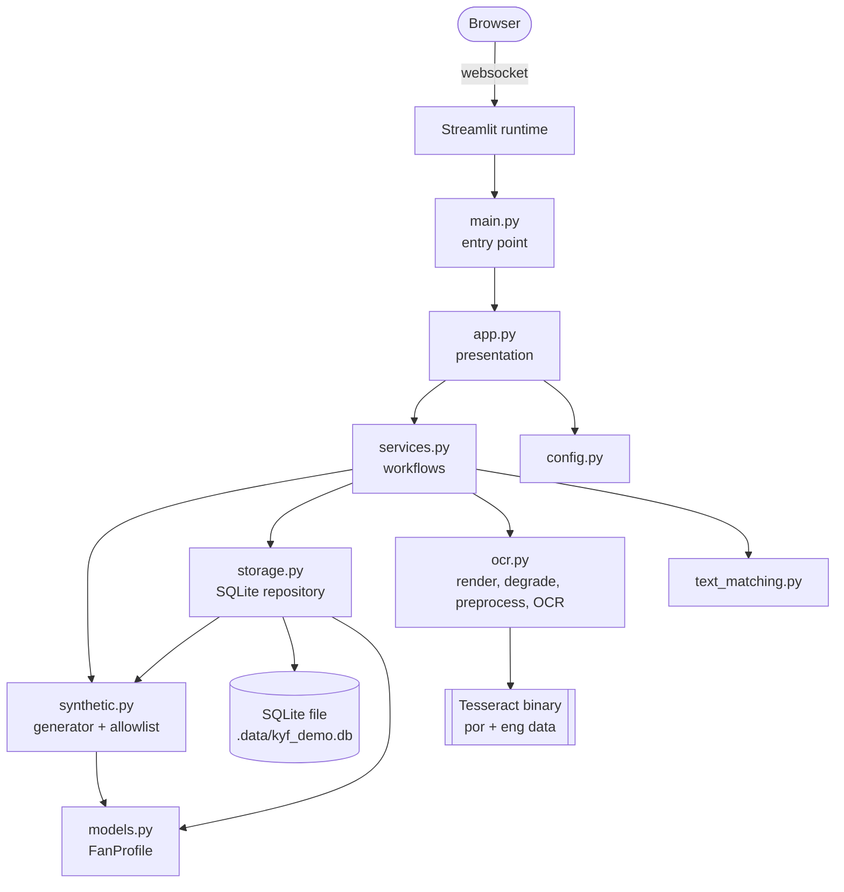
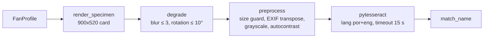

# Architecture

This document describes the code as it exists on the modernization branch. Planned work is
marked as such.

## Purpose and scope

Know Your Fan is an independent, synthetic-data-only demonstration of:

- generating and exploring fictional esports fan profiles;
- rendering fictional specimen cards, extracting their text with Tesseract OCR, and checking
  which words of a name appear in that text.

It does not handle real personal data. Its text matching is **not** identity verification,
document authentication, or fraud detection. See
[ADR 0002](decisions/0002-synthetic-data-only.md).

## Architectural style

The app is a **small modular monolith**: one Streamlit process and one Python package, with no
network services of its own ([ADR 0001](decisions/0001-streamlit-modular-monolith.md)).

- Presentation (`app.py`) is kept separate from workflows (`services.py`) and from domain and
  infrastructure modules.
- Dependencies point inward. Only `app.py` imports Streamlit, and no module imports `app.py`.
- Importing any module has no side effects. Configuration is read when `load_settings()` is
  called, and the database is touched only through repository methods.

## Module responsibilities

| Module | Responsibility | Depends on |
|---|---|---|
| `main.py` | Entry point for `streamlit run`. Falls back to `src/` on the import path when the package is not installed. | `app` |
| `app.py` | Streamlit pages, widgets, and user-facing messages. No business rules. | `services`, `config`, error types |
| `services.py` | Workflows: open and seed the repository, filter profiles, render cards, run OCR plus matching. | domain modules |
| `config.py` | Builds `Settings` from environment variables (`KYF_DB_PATH`). | — |
| `models.py` | `FanProfile`, a frozen dataclass. | — |
| `synthetic.py` | Deterministic profile generator and the synthetic-data allowlist (`synthetic_violations`). | `models` |
| `storage.py` | SQLite repository: schema, insert, count, list. Enforces the allowlist and the size cap. | `models`, `synthetic` |
| `ocr.py` | Specimen rendering, bounded degradations, preprocessing, Tesseract wrapper, error mapping. | Pillow, pytesseract |
| `text_matching.py` | Accent- and case-insensitive whole-word name matching. | — |

## Main user workflows

1. **Explore.** `app.page_explorer` reads all profiles and calls `services.filter_profiles`, which
   applies a name/city substring (at most 50 characters) and game filters. Results are shown in
   `st.dataframe`, and details as plain text.
2. **Generate.** The visitor picks a numeric seed (0–1,000,000,000).
   `synthetic.generate_profile(random.Random(seed))` creates a profile, which is kept in session
   state and can be added to the dataset.
3. **Text matching.**
   1. The visitor picks a stored profile and sets blur (0–3) and rotation (±10°).
   2. `services.render_card` draws the specimen and applies the degradations.
   3. `services.run_text_matching` validates the expected name, runs OCR, and returns the
      extracted text and a `MatchResult`.

## Synthetic data generation

- Generation is seeded and deterministic: `generate_profiles(n, seed)` always returns the same
  profiles.
- Demo IDs follow `KYF-DEMO-XXXX-XXXX` over a 30-character alphabet that leaves out `0 1 I L O U`.
  They always contain a letter, so they cannot be read as a CPF.
- Names combine one given name and two surnames from fixed lists, which include accented forms.
  Cities are fictional, and links use the reserved `.example` TLD.
- `synthetic_violations(profile)` is an **allowlist**. A profile is acceptable only if every value
  belongs to the generator's vocabulary. Free text such as an address or a CPF is rejected.

## Storage lifecycle

- `services.open_repository` runs once per process, cached with `st.cache_resource`. It creates
  the schema if needed and seeds 25 profiles (seed 2025) when the table is empty.
- Each repository method opens its own connection (`sqlite3.connect(..., timeout=5)`), runs inside
  a transaction (commit on success, rollback on error), and **always closes** it. No connection
  outlives a Streamlit rerun.
- `add()` refuses profiles that fail the allowlist (`UnsafeProfileError`) before opening a
  connection. It also enforces the 500-profile cap (`StorageLimitError`) and ignores duplicate IDs.
- `sqlite3` and filesystem errors are wrapped in `StorageError`, and the UI shows a friendly
  message instead of a traceback.
- The database file is local and disposable. It is git-ignored, and its location is set by
  `KYF_DB_PATH` (default `.data/kyf_demo.db`) ([ADR 0003](decisions/0003-sqlite-demo-storage.md)).

## OCR processing flow

- Cards are drawn with a bundled font (Aileron Regular, CC0, in `assets/fonts/`), loaded through
  `importlib.resources`. Pillow's built-in default font has no accented glyphs, which made names
  such as "João" render incorrectly. A unit test now checks glyph coverage for every character
  the card can contain.
- Images must be non-empty and at most 4 megapixels (`InvalidImageError`).
- Tesseract errors are mapped to two types:
  - `OCRUnavailableError`: the binary or its language data is missing.
  - `OCRFailedError`: the engine failed or timed out.
- No uploaded image ever reaches this pipeline; only images the app renders itself do.

## Text matching

`match_name(expected, text)` works as follows:

1. NFKD-normalizes both strings, removes combining marks, and case-folds them.
2. Splits them into alphabetic tokens.
3. Removes duplicate expected tokens.
4. Reports which tokens appear as whole words in the text.

Names that are blank, longer than 100 characters, or have no letters are rejected with a
`ValueError` before OCR runs. Whole-word matching avoids the substring false positives of the
original version, such as "Ana" matching inside "Mariana". The matcher has no tolerance for OCR
character errors.

## Configuration and dependencies

| Item | Source |
|---|---|
| Database path | `KYF_DB_PATH` environment variable |
| Streamlit behaviour | `.streamlit/config.toml`: error details hidden, usage stats off, upload limit 1 MB |
| Python dependencies | `pyproject.toml` (lower bounds) and `uv.lock` (exact versions); `requirements.txt` is exported from the lock |
| System dependency | Tesseract 5.x with `por` and `eng` data (`packages.txt`, CI, `Dockerfile`) |

See [ADR 0004](decisions/0004-packaging-and-dependencies.md) and
[ADR 0005](decisions/0005-ocr-engine-and-environment.md).

## Error handling

| Error | Raised by | Shown to the visitor as |
|---|---|---|
| `StorageError` | storage | "The demo dataset is unavailable …" (the app stops cleanly) |
| `StorageLimitError` | storage | Warning on the generator page |
| `UnsafeProfileError` | storage | Never expected from the UI; it guards against programming errors |
| `ValueError` (name) | text_matching | Error message, and OCR is not run |
| `InvalidImageError`, `OCRFailedError` | ocr | "OCR failed: …" |
| `OCRUnavailableError` | ocr | "OCR is unavailable in this environment: …" |

Anything unexpected is still caught by Streamlit, which is configured not to show stack traces
(`client.showErrorDetails = "none"`).

## Testing strategy

| Layer | Location | Notes |
|---|---|---|
| Unit | `tests/unit/` | Generator, allowlist, matching, config, services, and OCR preprocessing. The Tesseract call is replaced only where the test is about error mapping. |
| Integration | `tests/integration/test_storage.py` | Real SQLite files in per-test temporary directories: transactions, connection closing, corrupt files, caps. |
| UI | `tests/integration/test_app.py` | `streamlit.testing.AppTest` runs the real `main.py`. It checks pages, the absence of sensitive inputs and misleading claims, and error paths. |
| End-to-end OCR | `tests/integration/test_ocr_e2e.py` | Runs the real Tesseract engine, with nothing mocked. Skipped locally if Tesseract is missing; **required in CI** (`KYF_REQUIRE_OCR=1`). |

Coverage is measured with branch coverage. CI enforces at least 90% overall, and separately at
least 90% for non-UI code. Coverage shows which code ran, not that it is correct.

## Known limitations

- Visitors can trigger OCR as often as they like; there is no rate limiting.
- SQLite on hosts with temporary filesystems loses generator-added profiles on restart.
- Name matching does not tolerate OCR character errors, and its accuracy has not been measured
  (planned for the research phase).
- Degradations are illustrative, not a calibrated capture model.
