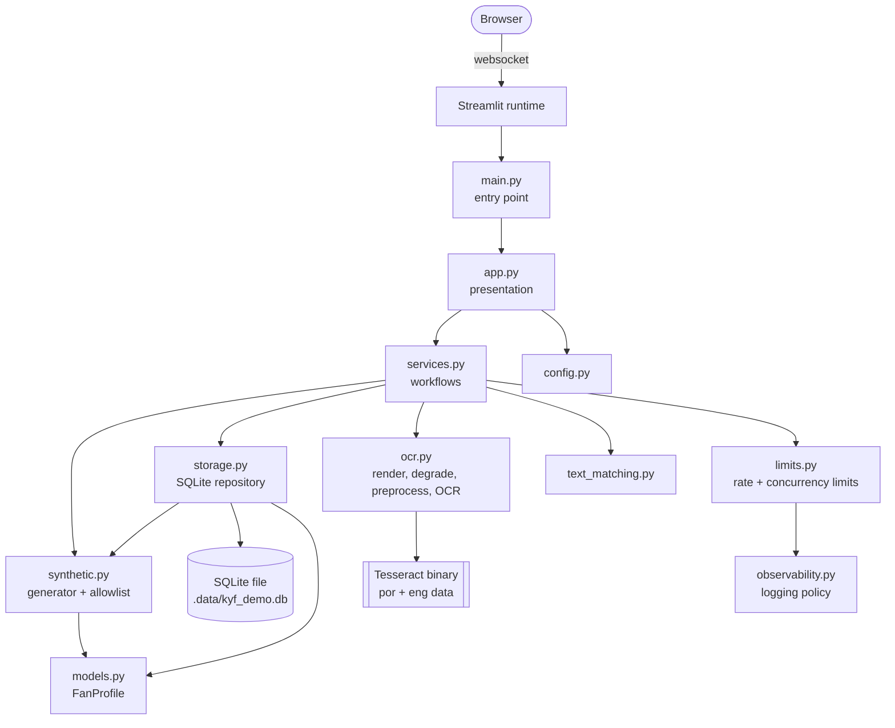
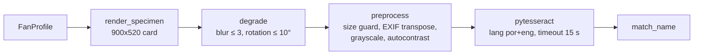

# Architecture

This document describes the code as it exists on the modernization branch. Planned work is
marked as such.

## Purpose and scope

Know Your Fan is an independent, synthetic-data-only demonstration of:

- generating and exploring fictional esports fan profiles;
- rendering fictional specimen cards, extracting their text with Tesseract OCR, and checking
  which words of a name appear in that text.

It does not handle real personal data. Its text matching is **not** identity verification,
document authentication, or fraud detection. See
[ADR 0002](decisions/0002-synthetic-data-only.md).

## Architectural style

The app is a **small modular monolith**: one Streamlit process and one Python package, with no
network services of its own ([ADR 0001](decisions/0001-streamlit-modular-monolith.md)).

- Presentation (`app.py`) is kept separate from workflows (`services.py`) and from domain and
  infrastructure modules.
- Dependencies point inward. Only `app.py` imports Streamlit, and no module imports `app.py`.
- Importing any module has no side effects. Configuration is read when `load_settings()` is
  called, and the database is touched only through repository methods.

## Module responsibilities

| Module | Responsibility | Depends on |
|---|---|---|
| `main.py` | Entry point for `streamlit run`. Falls back to `src/` on the import path when the package is not installed. | `app` |
| `app.py` | Streamlit shell (page config, logo, `st.navigation`, error guard) and the Home, Fans and OCR demo pages, with user-facing messages. No business rules. | `services`, `config`, `ui`, `research_page`, error types |
| `page_scripts/*.py` | One three-line script per section, registered with `st.navigation(position="top")`; each calls its render function. File pages keep the selected page across reruns (ADR 0008). | `app`, `research_page` |
| `research_page.py` | Interactive Research page (Altair charts and data tables) over precomputed results. | `research.presentation`, `ui` |
| `ui.py` | Design-system helpers: scoped stylesheet, brand assets, page header with the synthetic-data notice, step numbers, profile monogram (escaped initials only). Never renders other user data. | — |
| `services.py` | Workflows: build the process-wide `Runtime`, open and seed the repository, filter profiles, render cards, run OCR plus matching through admission control, rate-limit dataset additions. | domain modules, `limits` |
| `config.py` | Builds and validates `Settings` (database path and every operational limit) from environment variables; invalid values raise `ConfigurationError`. | — |
| `limits.py` | Sliding-window rate limiter, bounded concurrency limiter, and `OCRGuard` (per-session rate, global rate, then a concurrency slot). In-process only. | `config`, `observability` |
| `observability.py` | Logger setup and `ThrottledEvent`; defines the privacy-safe logging policy. | — |
| `models.py` | `FanProfile`, a frozen dataclass. | — |
| `synthetic.py` | Deterministic profile generator and the synthetic-data allowlist (`synthetic_violations`). | `models` |
| `storage.py` | SQLite repository: schema, insert, count, list. Enforces the allowlist and the size cap. | `models`, `synthetic` |
| `ocr.py` | Specimen rendering, bounded degradations, preprocessing, Tesseract wrapper, error mapping. | Pillow, pytesseract |
| `text_matching.py` | Name matching. `match_name_sequence` (M1: whole name, in order, on one line) is the app's rule; `match_name` (M0: words anywhere) is the original rule, kept as baseline and for word-level feedback. Accent- and case-insensitive, whole words only. | — |
| `research/presentation.py` | Read-only loading of precomputed research results for the Research page (standard library only). | — |
| `research/*` (other modules) | The offline experiment harness: dataset, degradations, preprocessing, matching, metrics, stats, runner, evaluation, reporting. Never imported by the app. | `ocr`, `synthetic`, `text_matching`, numpy; matplotlib for figures |

### Research harness (offline)

The harness reuses the application instead of re-implementing it:

- Cards come from `ocr.render_specimen`.
- The ground truth is `ocr.specimen_lines`, the same strings the renderer draws.
- Every OCR call goes through `ocr.recognize`, the engine entry point the app uses after its own
  preprocessing. Engine settings (language, timeout, error mapping) are therefore identical.
- The baseline preprocessing P0 is `ocr.preprocess` itself, and the baseline matcher M0 is
  `text_matching.match_name`.

Experiments run only from `scripts/run_research.py`. They are never run at app start-up or in
regular CI; CI runs a small real-Tesseract smoke test instead. See
[research/methodology.md](research/methodology.md) and [research/report.md](research/report.md).

## Main user workflows

1. **Explore.** `app.page_explorer` reads all profiles and calls `services.filter_profiles`, which
   applies a name/city substring (at most 50 characters) and game filters. Results are shown in
   `st.dataframe`, and details as plain text.
2. **Generate.** The visitor picks a numeric seed (0–1,000,000,000).
   `synthetic.generate_profile(random.Random(seed))` creates a profile, which is kept in session
   state and can be added to the dataset.
3. **Text matching.**
   1. The visitor picks a stored profile and sets blur (0–3) and rotation (±10°).
   2. `services.render_card` draws the specimen and applies the degradations.
   3. `services.run_text_matching` validates the expected name, runs OCR, and returns the
      extracted text and a `MatchResult`.

## Synthetic data generation

- Generation is seeded and deterministic: `generate_profiles(n, seed)` always returns the same
  profiles.
- Demo IDs follow `KYF-DEMO-XXXX-XXXX` over a 30-character alphabet that leaves out `0 1 I L O U`.
  They always contain a letter, so they cannot be read as a CPF.
- Names combine one given name and two surnames from fixed lists, which include accented forms.
  Cities are fictional, and links use the reserved `.example` TLD.
- `synthetic_violations(profile)` is an **allowlist**. A profile is acceptable only if every value
  belongs to the generator's vocabulary. Free text such as an address or a CPF is rejected.

## Storage lifecycle

- `services.build_runtime` runs once per process, cached with `st.cache_resource`. It opens the
  repository, creates the schema if needed, and seeds 25 profiles (seed 2025) in **one
  transaction**, so concurrent processes seed exactly once.
- Each repository method opens its own connection in autocommit mode (busy timeout 5 s by
  default) and **always closes** it. No connection outlives a Streamlit rerun.
- Writes use explicit **`BEGIN IMMEDIATE`** transactions. The write lock is taken before the
  duplicate and capacity checks, so the 500-profile cap holds across threads and processes. Any
  error rolls the transaction back.
- `add()` refuses profiles that fail the allowlist (`UnsafeProfileError`) before opening a
  connection, enforces the cap (`StorageLimitError`), and returns `False` for duplicate IDs.
- `SQLITE_BUSY` and `SQLITE_LOCKED` become `StorageBusyError`; other `sqlite3` and filesystem
  errors become `StorageError`. The UI shows friendly messages and logs record error codes only.
  See [operations.md](operations.md#sqlite-concurrency-storagepy).
- The database file is local and disposable. It is git-ignored, and its location is set by
  `KYF_DB_PATH` (default `.data/kyf_demo.db`) ([ADR 0003](decisions/0003-sqlite-demo-storage.md)).

## OCR processing flow

- Cards are drawn with a bundled font (Aileron Regular, CC0, in `assets/fonts/`), loaded through
  `importlib.resources`. Pillow's built-in default font has no accented glyphs, which made names
  such as "João" render incorrectly. A unit test now checks glyph coverage for every character
  the card can contain.
- Images must be non-empty and at most 4 megapixels (`InvalidImageError`).
- Tesseract errors are mapped to two types:
  - `OCRUnavailableError`: the binary or its language data is missing.
  - `OCRFailedError`: the engine failed or timed out.
- No uploaded image ever reaches this pipeline; only images the app renders itself do.

## Text matching

Both rules first NFKD-normalize the text, remove combining marks, case-fold, and split into
alphabetic tokens. Only whole words count, so "Ana" never matches inside "Mariana".

- **`match_name_sequence(expected, text)`, the app's rule (M1, since Phase 5):** a match requires
  the full token sequence of the name, order and repeats included, on a single OCR line. It returns
  a `SequenceMatch` with the decision, a verdict (`match`, `words_not_in_sequence`, `partial`,
  `none`), and word-level feedback for the UI.
- **`match_name(expected, text)`, the original rule (M0):** it reports which distinct tokens appear
  anywhere in the text. It is kept unchanged as the research baseline and for feedback. Phase 4
  showed that it accepts decoys that repeat a token of the true name.

Names that are blank, longer than 100 characters, or have no letters are rejected with a
`ValueError` before OCR runs. Neither rule tolerates OCR character errors; the reasons are in
[ADR 0007](decisions/0007-research-informed-matching-and-preprocessing.md).

## Configuration and dependencies

| Item | Source |
|---|---|
| Database path | `KYF_DB_PATH` environment variable |
| Operational limits | `KYF_OCR_*`, `KYF_MAX_*`, and `KYF_SQLITE_BUSY_TIMEOUT_SECONDS`, validated at start-up ([operations.md](operations.md#3-configuration)) |
| Tesseract threads | `OMP_THREAD_LIMIT`, set to 1 at start-up if absent |
| Streamlit behaviour | `.streamlit/config.toml`: error details hidden, usage stats off, upload limit 1 MB |
| Python dependencies | `pyproject.toml` (lower bounds) and `uv.lock` (exact versions); `requirements.txt` is exported from the lock |
| System dependency | Tesseract 5.x with `por` and `eng` data (`packages.txt`, CI, `Dockerfile`) |

See [ADR 0004](decisions/0004-packaging-and-dependencies.md) and
[ADR 0005](decisions/0005-ocr-engine-and-environment.md).

## Error handling

| Error | Raised by | Shown to the visitor as |
|---|---|---|
| `ConfigurationError` | config | "The demo is misconfigured …" (the app stops; values are not shown) |
| `StorageError` | storage | "The demo dataset is unavailable …" at start-up (the app stops cleanly), or "temporarily unavailable" while rendering a page |
| `StorageBusyError` | storage | Warning: "The demo database is busy. Please try again." |
| `StorageLimitError` | storage | Warning on the generator page |
| `RateLimitedError` | limits | Warning: "Too many requests. Please wait about N seconds …" (no OCR started) |
| `CapacityExceededError` | limits | Warning: "The OCR engine is busy …" (no OCR started) |
| `UnsafeProfileError` | storage | Never expected from the UI; it guards against programming errors |
| `ValueError` (name) | text_matching | Error message, and OCR is not run |
| `InvalidImageError`, `OCRFailedError`, `OCRTimeoutError` | ocr | "OCR failed: …" |
| `OCRUnavailableError` | ocr | "OCR is unavailable in this environment: …" |

Anything unexpected is still caught by Streamlit, which is configured not to show stack traces
(`client.showErrorDetails = "none"`).

## Testing strategy

| Layer | Location | Notes |
|---|---|---|
| Unit | `tests/unit/` | Generator, allowlist, matching, config validation, services, OCR preprocessing and error mapping, rate and concurrency limits (fake clock; threads synchronized with barriers and events, no sleeps), throttled logging, and log privacy. The Tesseract call is replaced only where the test is about error mapping or admission control. |
| Integration | `tests/integration/test_storage.py` | Real SQLite files in per-test temporary directories: transactions and rollback, connection closing, corrupt files, caps under concurrent writers, concurrent seeding, held-lock busy handling, and log privacy. |
| UI | `tests/integration/test_app.py` | `streamlit.testing.AppTest` runs the real `main.py`. It checks pages, the absence of sensitive inputs and misleading claims, error paths, rate-limit and busy-engine messages, fail-closed configuration, and that UI flows never log names or OCR text. |
| Research | `tests/unit/test_research_*.py`, `tests/integration/test_research_smoke.py` | Hand-calculated CER/WER, matcher, and FAR/FRR examples; bootstrap properties; dataset determinism, split disjointness, and leakage; transformation determinism and validation; config validation; resume and provenance; evaluation, reporting, and CLI with a fake engine; a real-Tesseract smoke run of the full CLI (required in CI). |
| Operational validation | `scripts/validate_limits.py` | Bounded workloads with invariant checks; run in CI with real Tesseract ([operations.md](operations.md#5-bounded-operational-validation)). |
| End-to-end OCR | `tests/integration/test_ocr_e2e.py` | Runs the real Tesseract engine, with nothing mocked. Invariants (engine, languages, card labels, no false match for an absent name, pipeline) are strict. Name recognition is an aggregate token-recall threshold of at least 90% on 11 clean cards ([ADR 0005](decisions/0005-ocr-engine-and-environment.md)). Skipped locally if Tesseract is missing; **required in CI** (`KYF_REQUIRE_OCR=1`). |

Coverage is measured with branch coverage. CI enforces at least 90% overall, and separately at
least 90% for non-UI code. Coverage shows which code ran, not that it is correct.

## Known limitations

- Resource limits are per process, and per-session limits are a fairness measure only; see
  [operations.md](operations.md#6-limitations-and-remaining-denial-of-service-risks).
- SQLite on hosts with temporary filesystems loses generator-added profiles on restart.
- Name matching does not tolerate OCR character errors. Its error rates were measured only on
  synthetic cards ([research report](research/report.md)).
- Degradations are illustrative, not a calibrated capture model.
