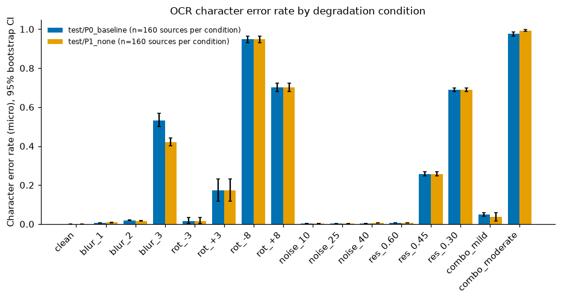
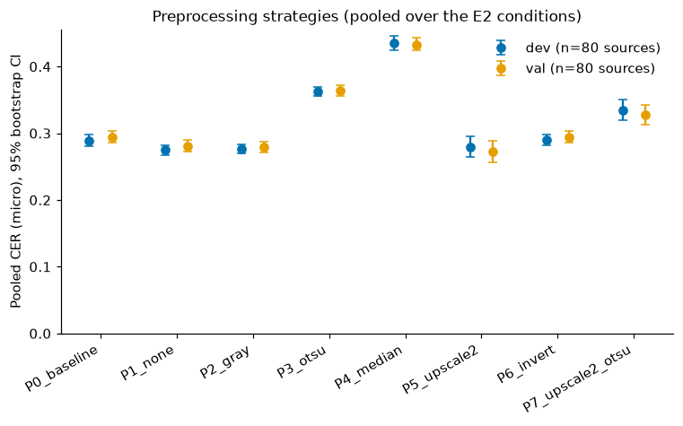
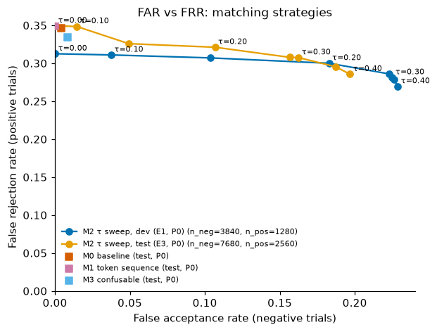
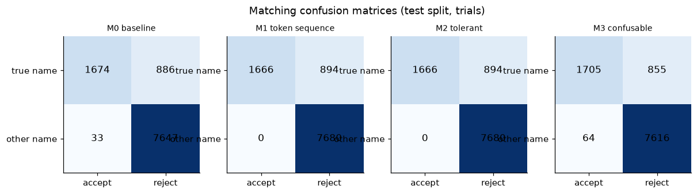
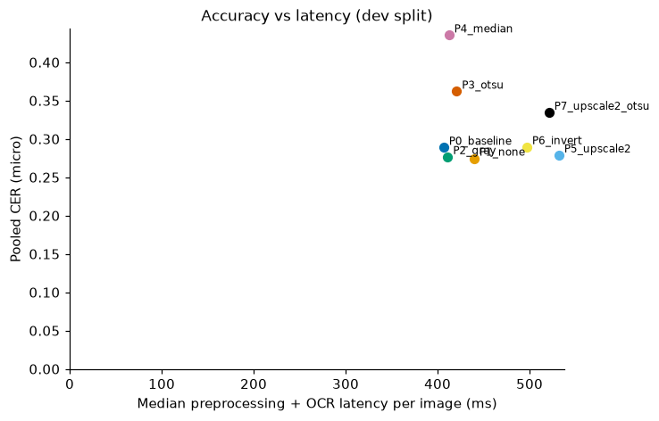

# Degradations, preprocessing, and matching rules in OCR-based name matching: a pre-registered study on synthetic specimen cards

*Know Your Fan, research report (Phase 4).* An independent, non-peer-reviewed technical report.
All data is synthetic. This study does **not** evaluate identity verification, document
authentication, or fraud detection.

## Abstract

We measure how controlled image degradations, image preprocessing, and name-matching rules affect
OCR transcription errors, name-matching error rates, and cost on fictional specimen cards rendered
by this project. The study used:

- 320 synthetic cards in leakage-free dev / val / test splits (80 / 80 / 160);
- 16 degradation conditions;
- 8 preprocessing strategies;
- 4 matching rules;
- 19,200 real Tesseract 5.4 OCR runs (plus a 768-run pilot).

Hypotheses and selection rules were committed before the main experiments. Choices were frozen on
dev/val, and the test split was evaluated once.

Findings:

- **Degradations:** clean cards transcribe almost perfectly (test CER 0.0003, 92.5 % exact).
  Moderate blur, noise, and 0.60× downscaling are harmless. ±8° rotation (CER 0.70–0.95), σ=3
  blur (0.53), and 0.30× resolution (0.69) are severe.
- **Preprocessing:** median filtering and Otsu thresholding hurt substantially. Inversion was
  neutral. 2× upscaling recovered 0.45×-resolution cards almost completely on dev/val.
- **The app's preprocessing:** its grayscale + autocontrast step was slightly worse than no
  preprocessing. On test, ΔCER(no preprocessing − app) was −0.0066 [−0.0092, −0.0041] pooled over
  16 conditions and −0.0140 [−0.0182, −0.0098] on the 9 conditions used for selection, but
  +0.0028 [+0.0011, +0.0045] on the 7 other conditions. WER and name-token recall did not change.
- **Matching (test):** FRR was 33–35 % for every rule, driven almost entirely by the severe
  conditions. The app's order-insensitive matcher (M0) falsely accepted 0.43 % of decoys, all from
  names containing near-duplicate tokens. A sequence-aware rule (M1) accepted none, at +0.3 pp FRR.
  Edit-distance tolerance traded FAR for FRR poorly (FAR 19.7 % for −6.4 pp FRR at τ=0.40). The
  pre-registered FAR-constrained rule therefore selected an effectively zero tolerance.
- **Cost:** matching cost about 0.4 ms per trial for all four rules together, about 1/900 of the
  median OCR time.

## 1. Introduction

The original Know Your Fan application (2025) compared a typed name with OCR output from an
uploaded identity document and showed "valid document" when the first name appeared anywhere in the
text. Phases 1–3 removed real-data collection and replaced that claim with an explicitly
synthetic, text-matching-only demonstration. Phase 4 asks a measurable question about what
remains:

> How do controlled image degradations and text-matching strategies affect the reliability, error
> rates, and computational cost of OCR-based name matching on synthetic document specimens?

We keep apart four things that the original app conflated:

1. **OCR transcription:** how close the text is to the card.
2. **Name-token recognition:** whether the name is recovered from the "Name:" line.
3. **Name matching:** whether a rule accepts the true name and rejects decoys.
4. **Identity verification:** who holds a genuine document. This is out of scope and not measured.

## 2. Research questions and hypotheses

The hypotheses were pre-registered in [methodology.md](methodology.md) (commit `621ac1c`), before
E1–E3 ran. A 6-card dev pilot had been seen; this is disclosed there. The verdicts below apply the
pre-registered criteria literally.

| ID | Hypothesis (abridged) | Result | Verdict |
|---|---|---|---|
| H1a | CER non-decreasing with blur and resolution severity (test, P0) | Blur 0.0003 → 0.006 → 0.019 → 0.533; resolution 0.0003 → 0.006 → 0.258 → 0.690 | **Supported** |
| H1b | Noise σ≤40 adds ≤ 0.02 CER (test) | +0.0021 | **Supported** |
| H1c | 8° rotation worse than 3° (test) | ±8°: 0.949 / 0.701; ±3°: 0.015 / 0.173 | **Supported** (strongly asymmetric at 3°; §7) |
| H2a | 2× upscaling lowers CER on reduced resolution (*test*) | Dev: res_0.45 0.249 → 0.001, res_0.30 0.699 → 0.447; val similar | **Supported on dev/val; not evaluable on test as worded.** E3 ran only P0 and the frozen strategy. This is a pre-registration inconsistency, disclosed in methodology §9. |
| H2b | Median filtering raises CER (dev, val) | ΔCER +0.147 / +0.139, CIs > 0 | **Supported** |
| H2c | Inversion does not improve CER (dev, val) | ΔCER +0.0007 / +0.0005, CIs ≥ 0 | **Supported** |
| H2d | Removing autocontrast or all preprocessing changes CER by < 0.01 (dev, val) | P1 −0.0143 / −0.0128; P2 −0.0122 / −0.0146 | **Not supported**: removing them *helped* by more than 0.01 |
| H3a | M1: FRR ≥ M0 and FAR ≤ M0 (test) | FRR 0.349 vs 0.346; FAR 0 vs 0.0043 | **Supported** |
| H3b | M2 (frozen τ) has lower FRR than M0 (test) | ΔFRR +0.0031 [+0.0012, +0.0055] | **Not supported** (M2 at τ=0.05 equals M1) |
| H3c | M2 raises near-miss FAR above M0 (test) | 0/2,560 vs 33/2,560 | **Not supported** (opposite direction) |
| H3d | M3: FRR < M1 and near-miss FAR ≤ M2's (test) | FRR 0.334 < 0.349 ✓; near-miss FAR 64/2,560 > 0 ✗ | **Not supported** (second clause fails) |
| H4a | Upscaling costs ≥ 20 % more latency (dev) | Median 532 / 406 ms = 1.31× | **Supported** |
| H4b | Matching < 1 ms per trial and ≥ 100× below OCR (test) | 0.41 ms for all four rules vs 384 ms OCR (≈ 930×) | **Supported** |
| H5a | Dev-selected preprocessing lowers CER on val and test | Val −0.0128 [−0.0203, −0.0052]; test −0.0066 [−0.0092, −0.0041] | **Supported**, with caveats (§7.2) |
| H5b | Frozen τ keeps test FAR ≤ 2 % | FAR(M2) = 0 | **Supported** (trivially; §7.3) |

## 3. Experimental setup

| Item | Value |
|---|---|
| Machine | Windows 10 (build 19045), Intel x86-64, 6 logical CPUs |
| OCR engine | Tesseract 5.4.0.20240606 (UB Mannheim build) via pytesseract 0.3.13 |
| Models | `tessdata_fast` 4.1.0 `eng` and `por`; SHA-256 `7d4322bd…` / `c4932b93…` |
| Settings | `lang=por+eng`, default page segmentation, 15 s timeout, `OMP_THREAD_LIMIT=1` |
| Software | Python 3.13.14, Pillow 12.3.0, numpy 2.5.4 |
| Parallelism | 3 worker processes, one Tesseract thread each |
| Dataset | `kyf-synth-names-v1`, seed 20261013, fingerprint `8c4422b5372c…`, identical for all runs |

| Run | OCR tasks | Wall time | Commit (clean tree) |
|---|---|---|---|
| Pilot | 768 | 146 s | `fbc007d` |
| E1, degradations × P0 (dev, val) | 2,560 | 427 s | `621ac1c` |
| E2, 9 conditions × 8 strategies (dev, val) | 11,520 | 1,866 s | `621ac1c` |
| E3, 16 conditions × {P0, P1} (test) | 5,120 | 776 s | `f392a64` (after the freeze) |

There were no OCR timeouts or failures in any run. Each run's provenance (commit, dirty flag,
configuration hash, model hashes, package versions) is in
`experiments/results/<run>/run_metadata.json`.

## 4. Synthetic dataset

- Names are built from 32 given-name and 30 surname **clusters of near-duplicates** (e.g.
  *Ivo/Ivan*, *Pereira/Ferreira*, *Iara/Lara*, *Moura/Mourão*). Patterns: two, three, or four
  tokens, with particles, compound given names, and repeated surnames. 56 % of dev, 74 % of val,
  and 59 % of test names contain diacritics.
- **Splits without leakage:** whole clusters are assigned to one split, stratified by token
  category. Splits share no given name or surname, only the particles *da, de, do, dos, das*. No
  vocabulary token collides with any other card text. Each card's ground truth is exactly the
  strings drawn on it.
- **Trials:** per card, one positive and three negatives:
  - *easy*: an unrelated name;
  - *token swap*: one token replaced within its role;
  - *near miss*: a cluster partner, or a one-letter look-alike edit for tokens without a partner.

  Class balance is 1:3. No trial had to be excluded as ambiguous. All rules are scored on exactly
  the same trials: on test, 160 positive and 480 negative trials per (condition, strategy), or
  2,560 and 7,680 pooled over the 16 conditions.

## 5. Methods

- **Degradations** (fixed order: rotate, blur, downscale, then seeded additive noise):

  | Family | Levels |
  |---|---|
  | Clean | one |
  | Gaussian blur σ | 1, 2, 3 |
  | Rotation | ±3°, ±8° |
  | Noise σ | 10, 25, 40 |
  | Resolution scale | 0.60, 0.45, 0.30 |
  | Combinations | mild (σ1, +3°, noise 10, 0.60×); moderate (σ2, −8°, noise 25, 0.45×) |

  This one-factor-at-a-time design with two combinations has 16 conditions and avoids a full
  factorial.
- **Preprocessing:** P0 is the application's own (grayscale + autocontrast). P1 is none and P2 is
  grayscale only; P3 adds Otsu thresholding, P4 a 3×3 median filter, P5 2× Lanczos upscaling, P6
  inversion, and P7 upscaling + Otsu.
- **Matching rules:**
  - M0 is the application's rule: every distinct normalized token appears anywhere.
  - M1 requires the full ordered token sequence, repeats included, on one line.
  - M2 is M1 with per-token normalized Levenshtein distance ≤ τ.
  - M3 is M1 after a fixed look-alike table (`rn→m`, `vv→w`, `cl→d`, `0→o`, `1/|/!/i→l`,
    `5/$→s`).
- **Selection rules, frozen before E3** (`experiments/configs/frozen_selection.json`):
  - S1: lowest dev CER over E2's 9 conditions, confirmed on val. Result: **P1**.
  - S2: largest τ with dev FAR ≤ 1 %. Result: **τ = 0.05**.

## 6. Metrics and statistics

- **CER and WER:** edit distance divided by reference length, after NFC normalization and
  whitespace collapsing, with case and diacritics preserved. Micro-averaged over a group.
- **Name-token precision/recall/F1:** multisets of normalized tokens after the "Name" label.
- **FAR** = FP / negatives; **FRR** = FN / positives. Undefined ratios are reported as n/a.
  Failures would count as empty transcripts; none occurred.
- **Latency:** wall-clock per task (median, p90, p95, max).
- **Intervals:** 95 % percentile intervals from a **source-level bootstrap** (B = 2,000, seed
  20261013). Whole cards are resampled with all their variants and trials. Paired differences
  reuse the same resampled cards.
- **Primary endpoints:**
  1. test ΔCER(frozen − P0);
  2. test FAR/FRR of M0–M3 under P0.

  Everything else is secondary. There are no p-values.

## 7. Results

The complete generated tables are in [results.md](results.md). The figures are in
[figures/](figures/).

### 7.1 Degradations (RQ1)



*Figure 1. Test-split CER per condition for P0 and P1 (160 cards each; 95 % bootstrap CIs).*

- **Harmless:** clean cards (CER 0.0003 [0.000, 0.001], exact transcription 92.5 %), blur σ≤2
  (≤ 0.019), every noise level (≤ 0.003), 0.60× resolution (0.006), and −3° rotation (0.015).
- **Severe:** −8° (0.949), +8° (0.701), σ=3 blur (0.533), 0.30× resolution (0.690), and the
  moderate combination (0.976).
- **Transition region:** 0.45× resolution (0.258) and **+3° rotation (0.173 [0.118, 0.231])**.
- **Asymmetry and heavy tails.** Rotation is asymmetric: −3° gives 0.015 but +3° gives 0.173. The
  +3° interval is wide because errors are concentrated in some cards (complete failures rather than
  uniform degradation). The asymmetry is also present on dev (0.003 vs 0.077) and val (0.002 vs
  0.068); its size on test is larger. We do not have a mechanistic explanation. Plausible
  contributors are Tesseract's deskew and line-finding behaviour with the expanded white canvas.
  This is a hypothesis, not a finding.
- Dev and val reproduce the test pattern within 0.05 CER for every condition except +3° rotation,
  which differs by 0.10 (dev 0.077, val 0.068, test 0.173).

Name-token recall follows CER. It is ≥ 0.95 on harmless conditions and falls to 0.24 (σ=3 blur),
0.27 (0.30×), 0.10 (+8°), 0.04 (−8°), and 0.008 (moderate combination).

### 7.2 Preprocessing (RQ2, RQ5)



*Figure 2. Pooled CER over the 9 E2 conditions on dev and val (80 cards each; 95 % CIs).*

Paired ΔCER versus P0, pooled over the 9 E2 conditions:

| Strategy | Dev ΔCER | Val ΔCER | Reading |
|---|---|---|---|
| P1 none | −0.0143 [−0.0192, −0.0091] | −0.0128 [−0.0203, −0.0052] | slightly better |
| P2 gray | −0.0122 [−0.0166, −0.0082] | −0.0146 [−0.0200, −0.0100] | slightly better |
| P5 upscale | −0.0100 [−0.0254, +0.0060] | −0.0216 [−0.0363, −0.0059] | better, more variable |
| P6 invert | +0.0007 [+0.0003, +0.0011] | +0.0005 [+0.0000, +0.0009] | neutral to slightly worse |
| P7 upscale + Otsu | +0.0457 | +0.0335 | worse |
| P3 Otsu | +0.0731 | +0.0701 | worse |
| P4 median | +0.1465 | +0.1392 | much worse |

- **Upscaling** is the only strategy with a large *conditional* benefit. At 0.45× resolution it
  reduced CER from 0.249 to 0.001 (dev) and 0.283 to 0.001 (val). At 0.30× it reduced CER from
  about 0.69 to 0.45. It also had the largest gain in name-token recall (+0.039 dev, +0.036 val).
  It ranked third on pooled dev CER, so rule S1 did not select it. On val its point estimate was
  the best of all strategies, but within the intervals of P1 and P2.
- **The application's P0 step is close to a no-op.** P0 and P1 produced byte-identical
  transcripts for 100 % of clean, rotated, and downscaled test cards. Differences arise only under
  blur and noise, where autocontrast and grayscale change pixel values (exploratory analysis of the
  E3 observations).
- **Generalization of the frozen choice (P1):**

  | Test conditions | ΔCER(P1 − P0) |
  |---|---|
  | All 16 (primary endpoint) | −0.0066 [−0.0092, −0.0041] |
  | The same 9 conditions used for selection | −0.0140 [−0.0182, −0.0098]: essentially identical to dev and val |
  | The 7 conditions never used for selection | **+0.0028 [+0.0011, +0.0045]**: P1 slightly worse |

  P1 is better on σ=3 blur (0.421 vs 0.533) and worse on noise σ=40 (0.006 vs 0.002) and the
  moderate combination (0.993 vs 0.976). **ΔWER (−0.0002 [−0.0019, +0.0018]) and Δ name-token
  recall (−0.0016 [−0.0048, +0.0015]) are indistinguishable from zero.** The CER gain does not
  reach the name tokens.

### 7.3 Matching (RQ3)



*Figure 3. FAR/FRR trade-off of M2 across τ on dev (E1) and test (E3), with M0, M1, M3 on test.
P0 preprocessing. Some labels near the top-left corner overlap; exact values are in the table
below.*

Test split, P0, pooled over 16 conditions (2,560 positive and 7,680 negative trials, 160 cards):

| Rule | FAR [95 % CI] | FRR [95 % CI] | False accepts by decoy kind (easy / swap / near-miss) | ΔFRR vs M0 |
|---|---|---|---|---|
| M0 app baseline | 0.0043 [0.0000, 0.0100] | 0.346 [0.334, 0.358] | 0 / 0 / 33 | — |
| M1 token sequence | 0.0000 [0.0000, 0.0000] | 0.349 [0.338, 0.361] | 0 / 0 / 0 | +0.0031 [+0.0012, +0.0055] |
| M2 tolerant (τ=0.05) | 0.0000 | 0.349 | 0 / 0 / 0 | identical to M1 |
| M3 confusable | 0.0083 [0.0027, 0.0154] | 0.334 [0.325, 0.343] | 0 / 0 / 64 | −0.0121 [−0.0191, −0.0051] |

- **FRR is dominated by OCR failure, not by the rule.** M0's test FRR is ≤ 0.04 on the harmless
  conditions, 0.10–0.18 in the transition region (0.45×, ±3°, σ=2 blur, mild combination), and
  0.89–1.00 on the severe ones. No string rule can recover a name the OCR did not produce.
- **M0's false accepts are structural.** All 33 come from 3 test names that contain a
  near-duplicate pair (*Tânia Tainá …*, *Rosimeire Telles Teles*, *Edu Moura Mourão*). The decoy
  repeats a token that is already present ("Tânia **Tânia** Rios Moraes"). M0 ignores order and
  repetition, so it accepts. This happens on every condition where OCR reads the name. It is a
  property of the application's matching rule, not of OCR. The wide FAR interval [0, 0.010]
  reflects that only 3 of 160 cards are responsible.
- **Tolerance buys little.** On test, τ=0.10 raises FAR to 1.5 % for −0.1 pp FRR; τ=0.40 raises
  FAR to 19.7 % for −6.4 pp FRR. Dev showed the same shape (3.8 % FAR at τ=0.10). The FAR
  constraint therefore selected τ=0.05, which permits no edits for tokens shorter than 20 letters,
  so M2 collapsed to M1. This is why H3b and H3c were not supported.
- **M3's gain has a matching cost.** M3 lowers FRR by 1.2 pp but accepts 2.5 % of near-miss
  decoys (64/2,560, from 6 cards). These are look-alike edits such as *Aibuquerque* for
  *Albuquerque* or *Llma* for *Lima*. Part of this is **by construction**: the decoy generator's
  look-alike substitutions (e.g. `l→i`) overlap M3's canonicalization (`i→l`). It still
  illustrates the general risk that confusable-tolerant matching accepts look-alike names.



*Figure 4. Confusion matrices on test (P0), all conditions pooled.*

### 7.4 Cost (RQ4)

- **OCR:** median 384 ms per card on test (p95 564 ms, max 2.1 s), with 3 parallel workers.
- **Preprocessing:** P0 itself costs 2.4 ms. On dev, upscaling raised median preprocessing + OCR
  from 406 to 532 ms (1.31×), and P7 to 521 ms.
- **Matching:** all four rules together take a median of 0.41 ms per trial (p95 0.66 ms), about
  1/900 of OCR time.

Choosing a matching rule is therefore free in practice, while preprocessing choices change OCR
cost by up to about 30 %.



*Figure 5. Pooled CER vs median latency per preprocessing strategy (dev, E2).*

## 8. Discussion

**Observations** (measured):

- Within this synthetic setup, image quality, especially rotation, strong blur, and very low
  resolution, determines most of the error.
- Matching rules mostly shift a small FAR. They cannot repair failed transcription.
- The application's two original design choices both had measurable weaknesses:
  - its preprocessing is a no-op or slightly harmful compared with sending the image unmodified;
  - its order-insensitive matcher accepts decoys that repeat a token of the true name.

**Interpretation** (our reading):

1. **Preprocessing is condition-specific.** The best global choice (P1) was selected on a subset
   of conditions. Its advantage disappeared, and slightly reversed, on unseen conditions, and it
   never improved the name tokens. Upscaling is the only step with large, explainable benefits, and
   only for low-resolution input. A deployment would need to detect such conditions rather than
   apply one pipeline everywhere. This was not tested here.
2. **Sequence-aware matching (M1) is the most defensible default in this setup.** It removed every
   observed false accept for +0.3 pp FRR, at negligible cost.
3. **Error tolerance is a FAR/FRR exchange at a poor rate** for these decoys. Under an explicit
   FAR budget, the tolerant rule became exact. This is a negative result worth keeping: "fuzzy
   matching improves OCR matching" did not hold under a pre-registered safety constraint.

**Unsuccessful approaches:**

- Otsu thresholding, median filtering, and their combination with upscaling all increased error.
- Inversion, which the 2025 app used, did nothing useful.
- M2 tolerance gave no usable operating point under a 1 % FAR budget.

## 9. Threats to validity

See [limitations.md](limitations.md) for the full list.

- **Construct:**
  - one card template, font, and renderer;
  - simple simulated degradations;
  - rule-generated decoys, including an overlap between decoy edits and M3's table;
  - name metrics that depend on the "Name" label being read.
- **Internal:**
  - the pilot was seen before the hypotheses were written;
  - the E2 condition subset was chosen after the pilot;
  - H2a's criterion referred to a comparison that E3 did not include;
  - the selection-on-subset effect (§7.2).
- **External:**
  - one engine, version, and model set (`tessdata_fast`) on one Windows machine; CI's Ubuntu
    Tesseract 5.3.4 already transcribed some cards differently in Phase 2;
  - latency is machine-specific.
- **Statistical:**
  - intervals describe card-to-card variability within this generator, not real-world uncertainty;
  - many secondary intervals are reported without multiplicity correction;
  - some effects (M0's FAR, +3° rotation) rest on a few cards, as their wide intervals show.

## 10. Limitations

Results on synthetic cards are **not** evidence about real documents, photographs, or populations.
Nothing here measures identity verification. The study did not compare a second OCR engine, did
not test perspective, lighting, or compression artefacts, and did not test adaptive (per-condition)
preprocessing.

## 11. Reproducibility

Everything needed to reproduce the study is committed:

- configurations (`experiments/configs/`);
- dataset manifests (`experiments/manifests/`);
- raw OCR observations as byte-reproducible gzip archives (`experiments/results/*/observations.csv.gz`);
- run metadata;
- the frozen selection;
- generated tables and figures.

```bash
uv sync --locked
# Re-analyse the committed observations (no OCR needed):
uv run python scripts/run_research.py evaluate --config experiments/configs/e1_degradation.toml
uv run python scripts/run_research.py evaluate --config experiments/configs/e2_preprocessing.toml
uv run python scripts/run_research.py evaluate --config experiments/configs/e3_test.toml
uv run python scripts/run_research.py report
# Re-run the OCR (Tesseract with eng+por required; about 1 h):
uv run python scripts/run_research.py run --config experiments/configs/e1_degradation.toml --environment <label>
```

Re-analysis reproduces every reported number except matching latency, which is re-measured. A
re-run on another machine or engine version will produce different transcriptions. Label it with
`--environment` and do not pool it with these results.

## 12. Conclusion

On synthetic cards:

- OCR-based name matching is reliable only when the image is good.
- Rotation, strong blur, and very low resolution account for most failures.
- No matching rule repairs a failed transcription.
- The application's own preprocessing was not helpful.
- The application's matcher accepted a structured class of decoys that a sequence-aware rule
  rejected at almost no cost in false rejections.
- Error-tolerant matching did not justify its false acceptances under a 1 % FAR budget.

These are statements about a controlled synthetic benchmark. They support engineering decisions
for this demonstration, not claims about identity verification.

## References

- Efron, B., & Tibshirani, R. J. (1993). *An Introduction to the Bootstrap.* Chapman & Hall.
- Field, C. A., & Welsh, A. H. (2007). Bootstrapping clustered data. *Journal of the Royal
  Statistical Society: Series B (Statistical Methodology)*, 69(3).
- Levenshtein, V. I. (1966). Binary codes capable of correcting deletions, insertions, and
  reversals. *Soviet Physics Doklady*, 10(8), 707–710.
- Otsu, N. (1979). A threshold selection method from gray-level histograms. *IEEE Transactions on
  Systems, Man, and Cybernetics*, 9(1), 62–66.
- Smith, R. (2007). An overview of the Tesseract OCR engine. *Ninth International Conference on
  Document Analysis and Recognition (ICDAR 2007)*, 629–633.
