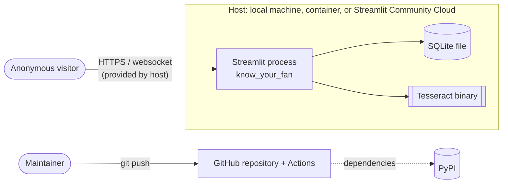

# Threat model

A lightweight, STRIDE-based threat model of the public synthetic-data demo, as implemented on
the modernization branch. "Implemented" means the mitigation exists in code or configuration
today; "Residual" covers what is not mitigated.

## System boundaries

- **Trust boundary 1:** visitor to Streamlit process. Everything a visitor sends (widget values)
  is untrusted.
- **Trust boundary 2:** repository to CI, and package registries to the build. Third-party code
  and actions are untrusted until pinned and verified.
- **Out of scope:** the host platform's TLS, network, and access logs. There is no deployment
  at present.

## Protected assets

| Asset | Why it matters |
|---|---|
| Visitors' real personal data | Must never be requested or stored. This is the main privacy goal. |
| Accuracy of claims | The app must never be presented or relied on as identity verification. |
| Availability of the demo | CPU (OCR) and disk (SQLite) are finite. |
| Integrity of the demo dataset | It should contain only generator output. |
| Repository and CI integrity | Secrets, dependencies, and workflow definitions. |

## Trust assumptions

- The operator controls environment variables (`KYF_DB_PATH`) and `.streamlit/config.toml`.
  Visitors cannot change them.
- The Tesseract binary and its language data come from the OS or the Docker image's package
  manager.
- Streamlit escapes text in `st.text`, `st.code`, and `st.dataframe`.

## STRIDE analysis

| Category | Threat scenario | Implemented mitigation | Residual risk |
|---|---|---|---|
| **Spoofing** | Someone presents a passed text match as proof of identity. | UI, README, and docs state "not identity verification", and no wording claims validity. Tests scan every page for misleading claims. | Users can still misread the output. Wording reduces this but cannot prevent it. |
| **Spoofing** | Someone impersonates the admin. | There is no admin or authentication; the hardcoded password was removed in Phase 1. | The old password is in Git history. It is treated as compromised and must never be reused. |
| **Tampering** | A visitor inserts arbitrary data (real CPF, address, script) into the dataset. | There are no free-text write paths. `storage.add` enforces the allowlist `synthetic_violations`, and SQL is parameterized. | None known for the UI. A code change that bypassed `add()` would bypass the allowlist. |
| **Tampering** | A compromised dependency or GitHub Action enters the build. | `uv.lock` pins versions and hashes; Actions are pinned to commit SHAs; gitleaks and actionlint binaries are checksum-verified; pre-commit hooks are pinned to SHAs. | Trust in PyPI and upstream maintainers remains. The lock must be refreshed to receive fixes. |
| **Repudiation** | A visitor denies adding profiles. | Not applicable: there are no accounts and no meaningful actions. | No audit log exists, by design. |
| **Information disclosure** | Stack traces reveal paths or internals. | `client.showErrorDetails = "none"`; storage and OCR errors become friendly messages. | Host-level logs may still contain tracebacks (operator-only). |
| **Information disclosure** | Real data is committed to Git. | `.gitignore` covers databases, `.env`, and secrets; gitleaks runs in pre-commit and on full history in CI. | gitleaks is pattern-based. Personal data that doesn't look like a secret (e.g. names) is not detected. |
| **Information disclosure** | Telemetry about visitors. | `browser.gatherUsageStats = false`. *(Phase 6)* A browser check found no requests to any origin other than the app, one technical XSRF cookie, and a theme preference in local storage. | The hosting platform's own logs. |
| **Tampering** | The app is framed by another site (clickjacking) or content is sniffed. | None in the app: Streamlit sends no `Content-Security-Policy`, `X-Frame-Options`, or `X-Content-Type-Options` headers. There are no accounts or state-changing actions worth hijacking beyond adding a synthetic profile. | Low. A host or reverse proxy should add these headers; see docs/deployment.md. |
| **Denial of service** | Repeated OCR requests exhaust CPU. | *(Phase 3)* Per-session (5/60 s) and process-wide (30/60 s) sliding-window rate limits, checked before Tesseract starts; invalid input is rejected without spending budget. Images are capped at 4 MP and 8,000 px per side; timeout is 15 s; uploads are not possible. | Limits are per process; replicas multiply them. Session limits can be bypassed with new sessions. One abuser can use up the global budget for one window, refusing other visitors. |
| **Denial of service** | Many simultaneous OCR jobs oversubscribe the CPU. | *(Phase 3)* At most 2 concurrent jobs per process (semaphore, 2 s bounded wait, no queue, always released). `OMP_THREAD_LIMIT=1` per Tesseract process: in CI, two concurrent jobs dropped from about 6.3 s to about 0.36 s each. | Per process only. A Tesseract process that ignores SIGTERM after a timeout could outlive its slot (not observed). |
| **Denial of service** | Unbounded dataset growth fills the disk. | 500-profile cap. *(Phase 3)* The cap check and the insert now run in one `BEGIN IMMEDIATE` transaction. **Correction:** the Phase 2 version of this document said the cap was "enforced in a transaction", but the check ran outside one; concurrent writers exceeded the cap in 20 of 20 measured trials. Per-session write limit of 10 per 10 min. *(Phase 6)* Process-wide write limit of 60 per 10 min, and a test with writers in separate processes. | Many sessions together can still fill the dataset to the cap, but no faster than 60 profiles per 10 minutes per process (about 80 minutes from the seeded state). A full dataset blocks further additions, not the app. |
| **Denial of service** | Locked SQLite database under concurrent writes. | Short write transactions; 5 s busy timeout (configurable); `StorageBusyError` with a friendly message; storage errors while rendering a page are caught. | Heavy concurrency could still produce "busy" messages. |
| **Information disclosure** | Operational logs reveal names, OCR text, or paths. | *(Phase 3)* Logs record event types, exit statuses, and SQLite error codes only; abuse-triggerable events are throttled. Tests assert that OCR text, names, profile data, and paths never appear in logs. | Third-party libraries (Streamlit, Uvicorn) log independently of this policy. |
| **Elevation of privilege** | The container process escapes or modifies the image. | The Docker image runs as an unprivileged user (UID 10001), and only `/app/.data` is writable by it. | Host and container runtime security are outside this project. |
| **Elevation of privilege** | CI token abuse. | The workflow token has `contents: read` only; checkout does not persist credentials; no secrets are used. | — |

## Unsafe rendering and injection

- **Markdown/HTML injection:** profile values and OCR output are rendered with `st.text`,
  `st.code`, or `st.dataframe`, never interpolated into Markdown or HTML (`app.py` module
  docstring). The fixed explanatory texts on the Home and Research pages use `st.write` with
  static strings only. Raw HTML is emitted only by `ui.py`, whose helpers escape their text
  arguments; `tests/unit/test_ui.py` fails if any other module passes `unsafe_allow_html`.
- **SQL injection:** all statements use bound parameters (`storage.py`).
- **Path injection:** the database path comes only from the operator-controlled `KYF_DB_PATH`.
- **Regular expressions:** all patterns are constants; user input is never compiled as a regex.

## OCR failure modes

| Failure | Effect | Handling |
|---|---|---|
| Tesseract or language data missing | No OCR possible | `OCRUnavailableError` and a friendly message; CI fails if this happens there. |
| Engine timeout | No text | *(Phase 3)* `OCRTimeoutError`; pytesseract terminates the subprocess and removes temp files; the concurrency slot is released (verified in CI with real timeouts: 0 slots held, 0 temp files left). |
| Engine crash or unexpected error | No text | `OCRFailedError` and a friendly message; no automatic retry. |
| Recognition errors (blur, rotation, fonts) | False "missing" words | Shown as a partial or no match. The Phase 4 study measured this on synthetic cards; edit-tolerant matching was evaluated and not adopted (ADR 0007). |
| Recognized text coincidentally containing the name | False "found" | Whole-word matching reduces this. It cannot be ruled out. |

## Residual risks summary

1. OCR limits are per process and not per client. Replicas multiply them, new sessions bypass
   session limits, and one abuser can use up the global budget for a window. See
   [operations.md](operations.md#6-limitations-and-remaining-denial-of-service-risks).
2. The Streamlit server itself (websockets, reruns, per-session memory) and network-level floods
   are not covered by application limits.
3. The meaning of a text match can still be misunderstood despite the disclaimers.
4. There is a window of dependency vulnerability between lock refreshes. CI audits on every push,
   and a weekly scheduled audit is configured, but it activates only after the workflow reaches
   the default branch (the final merge).
5. The historical password remains in Git history; it is compromised and must not be reused.
6. The behaviour on Streamlit Community Cloud is unverified because nothing has been deployed.
7. Streamlit sends no browser security headers; the host must add them (see docs/deployment.md).
